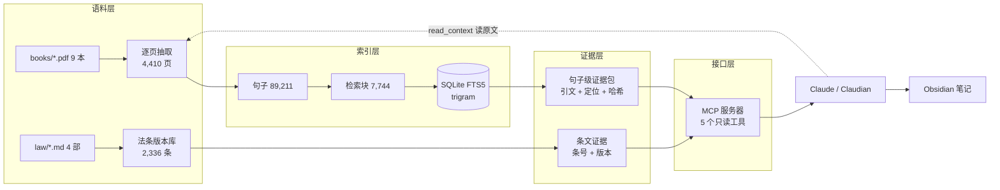

# legal_ai_obsidian

> 一个本地、离线、可溯源的法律语料检索层：**让每个论断都能回到原书某页、法条某条。**
>
> 给 Claude / Claudian 通过 MCP 调用，不作为公开服务运行。

---

## 它解决什么问题

常见的法律 AI 有三个毛病，这个项目是逐个对着修的：

| 毛病 | 表现 | 这里的做法 |
|---|---|---|
| **循环论证** | 「因为条文这样规定，所以条文这样规定」 | 材料分三层：条文（规范）/ 教科书（教义学）/ 法哲学（价值），推论必须跨层 |
| **伪造定位** | 页码、条号、作者随口编 | 引文只能由数据库句子记录生成；条号只能来自条文库 |
| **拼贴式回答** | 拿两句话凑一段看起来有出处的话 | 区分「引用」与「理解」：碎片用于引，连续正文用于读懂 |

---

## 三个设计主张

**1. 证据可核验，ID 不下发**

服务端内部有 `run_id` / `sentence_id` / 引文哈希，但**不会交给模型**——模型只拿到成品引用串。原因是：让模型抄 ID 一定会抄错（漏时区、丢字符），而它根本不需要知道。

**2. 判断归模型，取证归机器**

| 归模型 | 归机器 |
|---|---|
| 切哪些词、查哪些书、要不要价值层 | 打分公式、句子窗口、400 字上限 |
| 从结果里挑哪几条 | 页码一致性、质量标记、引用串生成 |

词典只在 `scope="auto"` 时兜底；默认**不限范围**。同时强制跑一次无过滤对照，把「路由可能太窄」暴露出来——`control.new_books` 非空就是这个信号。

**3. 状态必须诚实**

| 状态 | 含义 |
|---|---|
| `ok` | 有证据 |
| `no_hit` | 书在库里，但这次没命中——可以换词重试 |
| `not_covered` | 语料里根本没有——才可以说「未覆盖」 |

把「我没切对词」说成「语料未覆盖」，是这套系统最不能犯的错。

---

## 架构



一次问答的路径：

```
问题
 └─ evidence_search   → 碎片（1–2 句，可引用）
 └─ read_context      → 连续正文（1–2 页，可理解，不可引用）
 └─ books_catalog     → 书架目录（先看目录再选书）
 └─ law_article       → 条文 + 版本
      ↓
   模型推论 → 引文带链接、主要论断带页码
```

---

## 数字

| 项      | 值                                              |
| ------ | ---------------------------------------------- |
| 入库书籍   | **9 本** / 4,410 页 / 89,211 句 / 7,744 检索块       |
| 法条     | 4 部 / 2,336 条（民法典、刑法、公司法、民诉法）                  |
| 检索评测   | 36 道黄金问题：**Recall@10 0.970，Precision@5 0.894** |
| 单元测试   | **172 项**                                      |
| MCP 工具 | 5 个，全部只读                                       |


> **口径声明**：评测数据集覆盖 6 本（哈特、德沃金、卢梭、张明楷上/下、克伦钦格总则）。
> 合同法、民法总论、民诉教材三本尚未出题，指标不代表它们的质量。
> 报告里 `corpus_coverage` 字段会显式列出这三个缺口。

---

## 5 分钟跑通

仓库**不含书源与索引**（见上面的发布范围）。没有书源时，能验的是法与代码：

```powershell
# 1. 环境（Python 3.10+）
python -m pip install pypdf

# 2. 法条：按条号取条文 + 版本标签
python -m legal_ai legal-source show --law-id criminal-law-cn --article 20

# 3. 测试（依赖语料的用例会自动跳过）
python -m unittest discover -s legal_ai\tests
```

有书源时，按 `legal_ai/config/books.json` 把 PDF 放进 `books/`，再重建索引：

```powershell
python -m legal_ai inventory                 # 页数与 SHA-256 校验
python -m legal_ai ingest --all
python -m legal_ai process --all
python -m legal_ai build-index --rebuild
python -m legal_ai context "正当防卫 必要限度" --limit 3 --format markdown
```

`legal_ai/reports/inventory.json` 记录了每本书的页数与 SHA-256；持有同一版本 PDF 的人可以逐一核对，确认索引是从同一份语料重建的。

接入 Claude Code / Claudian：

```powershell
claude mcp add --scope project legal-ai -- <项目>\.venv\Scripts\python.exe -m legal_ai.mcp_server
```

（`.mcp.json` 里是绝对路径，换机器需要重写。）

---

## 目录

```
legal_ai/                 检索系统
├─ config/                书目、法源、部门法词典、层映射
├─ data/                  原文/句子/索引（**不入库**，版权）
├─ mcp_server.py          MCP 工具
├─ search.py              候选召回与打分
├─ evidence.py            证据包（句子级引文）
├─ citation.py            引用串渲染 + 内部字段隔离
├─ legal_source.py        法条版本库（append-only）
├─ query_terms.py         切词（词典种子 → 二元兜底）
├─ routing.py             路由与三态判定（纯函数）
└─ tests/                 172 项测试

books/                    原始 PDF（**仅本地**，不随仓库发布）
law/                      法条原文
scripts/                  规范化、MCP 冒烟等
.claude/skills/           写作契约（legal-concept-forge 等）
```

> **发布范围**：公开仓库只包含 `legal_ai/`、`law/`、`scripts/`、`.claude/`、`test/` 与根目录的说明文件。
> `books/`（书源受版权保护）、`personal src/`、`法学攻克系统/`（个人方法论文档）保持在本地，不进入公开仓库。

### 关于引用链接

笔记里的引用长这样：

```markdown
——[[books/天下·法律的概念.pdf#page=74|《法律的概念》第三版 p.74]]
```

这是 Obsidian 双链，指向**本地**书源。公开仓库不含书源，所以在 GitHub 上点击会 404——**这是有意的**：

- 书受版权保护，不能随仓库分发；
- 但书名、版次、页码都写在链接的**显示文本**里（`《法律的概念》第三版 p.74`），引用信息是完整的；
- 换句话说：链接服务于本地 Obsidian，引用服务于读者，两者都不牺牲。

持有同一版本 PDF 的人，把书放回 `books/` 后链接即恢复可点；`inventory` 会用 SHA-256 校验是不是同一本。

---

## 几个实现选择

**为什么不用向量数据库**
7,744 个检索块、512 维 float32 约 16 MB，暴力余弦在 CPU 上是毫秒级；引 ANN 省下的时间比索引自身开销还小。向量模块已实现（`embed.py` / `vector_index.py`），但因为 chunk 有 68% 超过 512 token 会被截断，**暂未接入**——先解决粒度问题。

**为什么法条要 append-only**
条文会变。改写历史会让旧引用指向不存在的文本，所以唯一允许的 UPDATE 是关闭生效区间；写错了就追加修正版本。每条引用带 `as_of`，可以时间旅行查询。

**为什么两字词单独处理**
SQLite FTS5 trigram 对三字以上中文才有效。两字法律术语（和解、管辖、证据）走参数化子串扫描——精确，但受候选上限约束。这是迁就 FTS5 能力边界做的权衡，不是设计偏好。

---

## 边界与未做

| 项 | 状态 |
|---|---|
| 6 本扫描书（罗克辛、耶赛克、克伦钦格债法/物权法、梅迪库斯、公司法经济结构） | ❌ 未 OCR |
| 向量召回 | ⏸ 已实现未接入 |
| 评测覆盖 | 6 / 9 本 |
| 公开语料 | ❌ 书源受版权保护，不入库、不发布 |

**它不是**：法律意见、在线服务、通用问答机器人。输出的每一条都是「材料」，判断在人。

---
